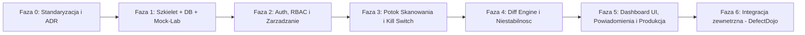

# Plan realizacji projektu (Roadmapa) — Attack Surface Intelligence (ASI)

Dokument definiuje podział prac od zakończonej standaryzacji (**Faza 0**) przez budowę autonomicznego rdzenia (*standalone*, **Fazy 1–5**) aż po dołączenie zewnętrznych integracji (**Faza 6**).

---

## Przegląd faz

---

## Faza 0: Standaryzacja i kontrakty *(Ukończona)*
* **Zakres:** Ujednolicenie wizji, zdefiniowanie standardów inżynieryjnych (`01`–`05`), modelu danych PostgreSQL, kontraktów REST/Worker/SSE, reguł potoku i diffów oraz zapisanie decyzji w `ADR-0001` – `ADR-0007`.
* **Kryterium wyjścia:** Spójny zestaw dokumentów w `docs/` oraz zaktualizowany dokument główny architektury.

---

## Faza 1: Szkielet monorepo, migracje DB i Docker Mock-Lab
* **Zakres:**
  * Workspace Rust (`Cargo.toml`, `asi-common`, `asi-api`, `asi-worker`) z konfiguracją `clippy`, `rustfmt`, `tracing` i `utoipa`.
  * Pierwsze migracje SQLx w `migrations/` dla całego modelu bazowego (`users`, `asset_groups`, `scan_policies`, `scan_runs`, `scan_chunks`, `ip_locks`, `hosts`, `host_ports`, `web_observations`, `diff_events`, `audit_logs` itd.).
  * Szkielet `asi-ui` (React + TypeScript + Vite + Tailwind + shadcn/ui + `react-i18next` `pl`/`en` + `openapi-typescript`).
  * Kompletny `deploy/docker-compose.dev.yml` wraz z usługami **Docker Mock-Lab** (`mock-web-standard`, `mock-nonstandard-http`, `mock-multivhost`, `mock-admin-staging`, `mock-flapping-host`, `mock-tarpit-host`).
* **Kryterium wyjścia:** `cargo test --workspace` przechodzi, migracje aplikują się na czystej bazie PostgreSQL, `asi-ui` buduje się z wygenerowanego OpenAPI i podnosi się z Mock-Labem.

---

## Faza 2: Uwierzytelnianie, RBAC i warstwa zarządzania zasobami
* **Zakres:**
  * Logowanie lokalne (`Argon2id` + JWT Access 15 min + rotowany Refresh Cookie z detekcją ponownego użycia).
  * Egzekwowanie 4 ról RBAC (`Admin`, `ReadWriteDelete`, `ReadWrite`, `ReadOnly`) oraz zapis do `audit_logs`.
  * CRUD dla `asset_groups`, `asset_group_targets` (IP/CIDR/domeny/wykluczenia), `scan_policies`, `ignored_targets` oraz `worker_nodes` (generowanie/unieważnianie tokenów).
  * Ujednolicony walidator Import / Export JSON (`schema_version: "1.0"`).
* **Kryterium wyjścia:** Testy integracyjne API potwierdzają pełną izolację uprawnień 4 ról RBAC, rotację sesji oraz poprawność walidacji JSON.

---

## Faza 3: Orkiestracja skanów, `asi-worker` i *Zero-Overlap Pipeline*
* **Zakres:**
  * *Dynamic Micro-chunking*, *Interleaving* podsieci, *Pre-flight Check* ($T_{\text{est}}$) oraz kolejka `FOR UPDATE SKIP LOCKED` + `ip_locks` (*Per-IP Lock & Cooldown*) w `asi-api`.
  * Protokół workera `/internal/v1/worker/*` (register, lease, heartbeat, control SSE, idempotentny ingest wyników, release).
  * Potok w `asi-worker`: Etap 1 (`Naabu`/`Masscan` + **Tarpit Guard**), Etap 2 (`Nmap -sV` wyłącznie na otwartych portach + `rustls`/`x509-parser` + rDNS/SAN), Etap 3 (Rust HTTP + **`FingerprintHub v4` YAML** + `MurmurHash3` favicony + opcjonalny `Nuclei`).
  * Implementacja **Hard Kill Switch** (`SIGTERM` → grace period → `SIGKILL` dla grupy procesów `-pgid`).
* **Kryterium wyjścia:** End-to-end test na Docker Mock-Lab przechodzi przez wszystkie 3 etapy (w tym non-standard port `8888`, dwa vhosty SNI, wykrycie `probable-tarpit` przy `>200` portach oraz przerwanie skanu w $\le 3\text{ s}$ ze zwrotem paczki do `PENDING`).

---

## Faza 4: Silnik zmian (Diff Engine), harmonogram dobowy i niestabilność
* **Zakres:**
  * Implementacja zasady *Scan-First Truth* oraz filtrowania szumu (nagłówki czasowe, dynamiczne wartości ciasteczek).
  * Maszyna stanów progu nieaktywności ($K=3$): `active` → `missing_pending` → `closed`.
  * Harmonogram okien czasowych i próbkowania w 4 slotach dobowych (`00_06`, `06_12`, `12_18`, `18_24`).
  * Rozróżnianie `confirmed_change` (*„Hej, coś się zmieniło”*) vs `active_variance` (*„Hej, coś się zmienia”*) i wyliczanie strukturalnych myślników `bullet_items`.
  * Live EMA ($\alpha=0.25$) i strumień **SSE** `/api/v1/events/stream`.
* **Kryterium wyjścia:** Automatyczne testy weryfikują brak fałszywych alarmów dla `mock-flapping-host` przy wahaniach dobowych oraz natychmiastowy `confirmed_change` po pojawieniu się nowej usługi lub panelu `/admin`.

---

## Faza 5: Kompletny Dashboard UI, powiadomienia i gotowość produkcyjna
* **Zakres:**
  * Widoki `asi-ui`: Dashboard (Live ETA, aktywne skany, kontrola Stop/Pause), Hosty i Usługi, Grupy Zasobów i Polityki, Diffy w myślnikach, Klastry podobnych usług (`favicon_mmh3`, tytuł, CMS), Edytor i synchronizator sygnatur `FingerprintHub v4`, Zarządzanie użytkownikami/workerami/audytem.
  * Implementacja `NotificationSink`: webhooki JSON (`HMAC-SHA256`), Slack, Microsoft Teams, Mattermost oraz opcjonalny SMTP wraz z kolejką retry.
  * Szablony `systemd` dla natywnego `asi-worker` (z `CAP_NET_RAW`) oraz produkcyjny `docker-compose.prod.yml` z szyfrowanym wolumenem `PGDATA` i TLS.
* **Kryterium wyjścia:** Pełny test akceptacyjny na Mock-Lab w trybie zbliżonym do produkcyjnego, przejście wszystkich bramek CI (Rust, migracje, OpenAPI drift, `asi-ui` i18n/lint/build).

---

## Faza 6: Integracja dwukierunkowa z DefectDojo *(Ukończona — patrz [ADR-0008](adr/ADR-0008-defectdojo-bidirectional-integration.md) i [standard 06](standards/06-defectdojo-integration.md))*
* **Zakres (zrealizowany):**
  * Mapowanie: `asset_group → Product ("ASI: <nazwa>")`, `scan_run → Engagement + Test ("ASI Attack Surface Scan")`, `diff_event → Finding` (upsert po `unique_id_from_tool`); ID w `external_refs JSONB` oraz tabeli `dd_links`.
  * Dwukierunkowy konektor REST API v2 DefectDojo **bez `reimport-scan`** (push: outbox `dd_outbox` z retry 10s/30s/2m/10m/30m, auto-push po diffie i po zakończonym runie + ręczny sync/push z UI; pull: statusy i tagi findingów co `pull_interval_minutes` → SSE `defectdojo.finding_updated`).
  * Konfigurowalny zakres findingów: `changes` | `all_diffs` | `inventory`; migracja `20261122000001_defectdojo_integration.sql` (`defectdojo_config`, `dd_outbox`, `dd_links`).
  * Bezpieczeństwo: API key jako AES-256-GCM w bazie (konto „AGH” w DD), RBAC `manage_external_integrations` (Admin) dla mutacji, `audit_logs`, TLS do DD.
  * UI: zakładka **Integracje (DefectDojo)** (konfiguracja, test połączenia, sync, kolejka outbox) + badge `DD #id · status` i przycisk *Wyślij do DD* na liście diffów; i18n pl/en.
  * Testy: `crates/asi-api/tests/dd_integration.rs` (mock API v2 bez bazy + pełny flow na żywym PostgreSQL: `cargo test -p asi-api --test dd_integration -- --include-ignored`).
  * Dev: `docker compose -f deploy/docker-compose.dev.yml --profile dd up -d` (lokalny DefectDojo obok Mock-Lab).
* **Kryterium wyjścia:** spełnione — push idempotentny, pull aktualizuje statusy, RBAC wymusza 403 dla ról bez uprawnień, `make ci` zielone.
* **Kryterium wyjścia:** Dwukierunkowa synchronizacja ASI $\Longleftrightarrow$ DefectDojo działa bez wpływu na stabilność i wydajność rdzenia skanującego.
