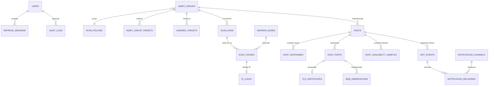

# Standard 02: Słownik domenowy, zasada Scan-First Truth i model danych

**Status:** Obowiązujący (Faza 0)  
**Data:** 2026-11-21

---

## 1. Kanoniczny słownik domenowy

| Identyfikator angielski (kod / API / DB) | Termin polski | Definicja kanoniczna |
|---|---|---|
| `AssetGroup` (`asset_groups`) | Grupa Zasobów | Logiczny zbiór celów (CIDR, pojedyncze IP, domeny) współdzielący politykę skanowania, harmonogram i progi nieaktywności. |
| `ScanPolicy` (`scan_policies`) | Polityka Skanowania | Zestaw parametrów operacyjnych: zakres portów, limity tempa (`rate`), współbieżność, czas łaski Kill Switcha, próg nieaktywności $K$ oraz próg *Tarpit Guard*. |
| `IgnoredTarget` (`ignored_targets`) | Cel Ignorowany | Adres IP, podsieć CIDR lub nazwa domenowa wykluczona ze skanowania i alertowania z obowiązkowym uzasadnieniem audytowym. |
| `ScanRun` (`scan_runs`) | Przebieg Skanu | Pojedyncze wykonanie skanu dla wybranej Grupy Zasobów (uruchomione ręcznie lub przez harmonogram). |
| `ScanChunk` (`scan_chunks`) | Mikro-paczka | Atomowa jednostka pracy wyliczona przez *Dynamic Micro-chunking* i dzierżawiona przez `asi-worker` z `asi-api`. |
| `IpLock` (`ip_locks`) | Blokada Per-IP | Rekord gwarantujący, że w danej chwili maksymalnie jeden proces komunikuje się z danym IP i zachowuje wymagany *cooldown*. |
| `Host` (`hosts`) | Host | Kanoniczna reprezentacja odkrytego lub skonfigurowanego adresu IP w ramach Grupy Zasobów. |
| `HostHostname` (`host_hostnames`) | Nazwa / Vhost | Nazwa domenowa powiązana z hostem (z wejścia użytkownika, rDNS `PTR` lub TLS `SAN`) wykorzystywana do separacji *Virtual Hostingu*. |
| `HostPort` (`host_ports`) | Port / Usługa | Wykryty port sieciowy oraz zidentyfikowana usługa (Etapy 1–2) wraz z maszyną stanów nieaktywności (`active` / `missing_pending` / `closed`). |
| `WebObservation` (`web_observations`) | Obserwacja Webowa | Wynik pasywnego fingerprintingu z Etapu 3 dla krotki `(host_id, port, protocol, vhost)` — w tym dopasowania `FingerprintHub v4` i metadane ciasteczek. |
| `DiffEvent` (`diff_events`) | Zdarzenie Zmiany | Wpis generowany przez Diff Engine klasyfikowany jako `confirmed_change` (*„Hej, coś się zmieniło”*) lub `active_variance` (*„Hej, coś się zmienia”*). |
| `SignatureRule` (`signature_rules`) | Reguła Sygnatury | Reguła detekcyjna w natywnym formacie **`FingerprintHub v4` (YAML)** (wbudowana, zsynchronizowana z repozytorium lub własna z UI). |
| `NotificationChannel` (`notification_channels`) | Kanał Powiadomień | Konfiguracja dostarczania alertów (Webhook JSON, Slack, Teams, Mattermost, SMTP) powiązana z polityką powiadomień. |

---

## 2. Zasada *Scan-First Truth* — ścisły podział kolumn

System rygorystycznie rozdziela warstwę **stanu technicznego** (odzwierciedlającą najnowszą rzeczywistość sieciową) od warstwy **analitycznej** (wiedzy i decyzji zespołu bezpieczeństwa).

| Kategoria | Przykładowe pola w DB | Zasada aktualizacji przez silnik skanowania |
|---|---|---|
| **Stan techniczny** (prawda po stronie skanu) | `hosts.status`, `hosts.is_probable_tarpit`, `host_ports.*` (`state`, `service_name`, `product`, `version`, `tunnel`), `tls_certificates.*`, `web_observations.*` (`http_status`, `title`, `redirect_url`, `favicon_mmh3`, `matched_technologies`, `cookies_meta`, `detected_paths`) | Kolejny ukończony skan **zawsze nadpisuje** bieżący stan techniczny najnowszymi danymi z sieci. Poprzednie wartości są rejestrowane w `diff_events` oraz `audit_logs` (`actor_type = 'scan_engine'`). |
| **Warstwa analityczna** (nigdy nienadpisywana przez skan) | `hosts.notes`, `hosts.manual_tags`, `hosts.owner_hint`, `hosts.tarpit_override_by`, `ignored_targets.*`, `hosts.external_refs` | Skan **nigdy nie kasuje ani nie nadpisuje** danych wpisanych przez analityków ani referencji zewnętrznych (`external_refs`). |

---

## 3. Diagram encji i relacji (ER)

---

## 4. Specyfikacja schematu PostgreSQL (`asi-db`)

Konwencje ogólne:
* Klucze główne: `UUID` (preferowane `UUIDv7` lub `gen_random_uuid()` w warstwie aplikacji/DB).
* Wszystkie znaczniki czasu: `TIMESTAMPTZ` w UTC.
* Adresy sieciowe: natywne typy PostgreSQL `INET` oraz `CIDR` (umożliwiające indeksowanie GiST/inet_ops dla zapytań o przynależność podsieci).
* Elastyczne metadane i przyszłe integracje: `JSONB`.

### 4.1. Tożsamość, sesje i węzły wykonawcze
* **`users`**
  * `id UUID PK`, `username TEXT UNIQUE NOT NULL`, `email TEXT UNIQUE NOT NULL`, `password_hash TEXT NOT NULL` (Argon2id), `role TEXT NOT NULL CHECK (role IN ('Admin', 'ReadWriteDelete', 'ReadWrite', 'ReadOnly'))`, `is_active BOOLEAN NOT NULL DEFAULT TRUE`, `preferred_locale TEXT NOT NULL DEFAULT 'pl'`, `created_at`, `updated_at`, `last_login_at`.
* **`refresh_sessions`**
  * `id UUID PK`, `user_id UUID FK -> users(id) ON DELETE CASCADE`, `family_id UUID NOT NULL`, `token_hash TEXT UNIQUE NOT NULL` (SHA-256), `expires_at TIMESTAMPTZ NOT NULL`, `revoked_at TIMESTAMPTZ`, `replaced_by_id UUID`, `created_ip INET`, `user_agent TEXT`, `created_at`.
  * Indeksy: `(user_id)`, `(family_id)`, `(expires_at)`.
* **`worker_nodes`**
  * `id UUID PK`, `name TEXT UNIQUE NOT NULL`, `segment_tag TEXT`, `token_hash TEXT UNIQUE NOT NULL`, `status TEXT NOT NULL CHECK (status IN ('online', 'offline', 'draining', 'revoked'))`, `capabilities JSONB NOT NULL`, `max_concurrency INTEGER NOT NULL`, `last_heartbeat_at TIMESTAMPTZ`, `registered_at`, `revoked_at`.

### 4.2. Konfiguracja skanów i wykluczenia
* **`scan_policies`**
  * `id UUID PK`, `name TEXT UNIQUE NOT NULL`, `port_spec TEXT NOT NULL` (np. `"1-65535"` lub `"top-1000"`), `discovery_tool TEXT NOT NULL CHECK (discovery_tool IN ('naabu', 'masscan'))`, `rate_pps INTEGER NOT NULL`, `per_ip_cooldown_ms INTEGER NOT NULL`, `subnet_concurrency INTEGER NOT NULL`, `kill_grace_seconds INTEGER NOT NULL DEFAULT 3 CHECK (kill_grace_seconds BETWEEN 1 AND 10)`, `inactivity_threshold INTEGER NOT NULL DEFAULT 3`, `tarpit_port_threshold INTEGER NOT NULL DEFAULT 200`, `enable_nuclei BOOLEAN NOT NULL DEFAULT FALSE`, `time_windows JSONB NOT NULL` (harmonogram okien czasowych i slotów próbkowania dobowego), `created_at`, `updated_at`.
* **`asset_groups`**
  * `id UUID PK`, `name TEXT UNIQUE NOT NULL`, `description TEXT`, `policy_id UUID FK -> scan_policies(id)`, `schedule_cron TEXT`, `sampling_enabled BOOLEAN NOT NULL DEFAULT TRUE`, `external_refs JSONB NOT NULL DEFAULT '{}'::jsonb` *(neutralny punkt rozszerzenia pod przyszłe integracje zewnętrzne)*, `created_by UUID FK -> users(id)`, `created_at`, `updated_at`.
* **`asset_group_targets`**
  * `id UUID PK`, `asset_group_id UUID FK -> asset_groups(id) ON DELETE CASCADE`, `target_type TEXT NOT NULL CHECK (target_type IN ('ip', 'cidr', 'domain', 'exclude_cidr'))`, `value TEXT NOT NULL`, `notes TEXT`, `created_at`.
  * Ograniczenie unikalności: `UNIQUE (asset_group_id, target_type, value)`.
* **`ignored_targets`**
  * `id UUID PK`, `asset_group_id UUID FK -> asset_groups(id) ON DELETE CASCADE` (`NULL` oznacza globalną listę ignorowanych), `target_type TEXT NOT NULL CHECK (target_type IN ('ip', 'cidr', 'domain'))`, `value TEXT NOT NULL`, `reason TEXT NOT NULL`, `created_by UUID FK -> users(id)`, `created_at`.

### 4.3. Orkiestracja, kolejka mikro-paczek i blokady Per-IP
* **`scan_runs`**
  * `id UUID PK`, `asset_group_id UUID FK -> asset_groups(id)`, `policy_snapshot JSONB NOT NULL` (zamrożona polityka z chwili startu), `trigger_type TEXT NOT NULL CHECK (trigger_type IN ('manual', 'scheduled', 'sampling'))`, `time_slot TEXT CHECK (time_slot IN ('00_06', '06_12', '12_18', '18_24'))`, `status TEXT NOT NULL CHECK (status IN ('queued', 'running', 'pausing', 'paused', 'stopping', 'stopped', 'completed', 'failed'))`, `total_targets INTEGER NOT NULL`, `total_chunks INTEGER NOT NULL`, `completed_chunks INTEGER NOT NULL DEFAULT 0`, `ema_chunk_ms DOUBLE PRECISION`, `estimated_finish_at TIMESTAMPTZ`, `started_by UUID FK -> users(id)`, `started_at`, `finished_at`, `cancel_requested_at`.
* **`scan_chunks`**
  * `id UUID PK`, `scan_run_id UUID FK -> scan_runs(id) ON DELETE CASCADE`, `sequence_no INTEGER NOT NULL`, `subnet_bucket TEXT NOT NULL` (używane do *Interleaving*), `targets JSONB NOT NULL` (lista IP + ewentualnych domen/vhostów w paczce), `status TEXT NOT NULL CHECK (status IN ('pending', 'leased', 'completed', 'failed', 'cancelled'))`, `attempt_no INTEGER NOT NULL DEFAULT 0`, `leased_by_worker_id UUID FK -> worker_nodes(id)`, `lease_expires_at TIMESTAMPTZ`, `last_heartbeat_at TIMESTAMPTZ`, `duration_ms INTEGER`, `error_message TEXT`, `created_at`, `completed_at`.
  * **Indeks krytyczny pod kolejkę `FOR UPDATE SKIP LOCKED`:** `CREATE INDEX idx_scan_chunks_queue ON scan_chunks (scan_run_id, sequence_no) WHERE status = 'pending';` oraz indeks wygasłych dzierżaw `(status, lease_expires_at) WHERE status = 'leased'`.
* **`ip_locks`**
  * `ip_addr INET PRIMARY KEY`, `locked_by_chunk_id UUID NOT NULL FK -> scan_chunks(id) ON DELETE CASCADE`, `locked_by_worker_id UUID NOT NULL FK -> worker_nodes(id)`, `locked_until TIMESTAMPTZ NOT NULL`, `cooldown_until TIMESTAMPTZ NOT NULL`.
  * Pozwala na atomowe sprawdzenie i zajęcie blokady Per-IP oraz przestrzeganie *cooldown* po stronie `asi-api` podczas wydawania paczki.

### 4.4. Inwentarz hostów, portów, TLS i obserwacji HTTP
* **`hosts`**
  * `id UUID PK`, `asset_group_id UUID FK -> asset_groups(id) ON DELETE CASCADE`, `ip_addr INET NOT NULL`,
  * *Kolumny techniczne (Scan-First Truth):* `status TEXT NOT NULL CHECK (status IN ('active', 'missing_pending', 'inactive', 'ignored'))`, `consecutive_misses INTEGER NOT NULL DEFAULT 0`, `is_unstable BOOLEAN NOT NULL DEFAULT FALSE`, `is_probable_tarpit BOOLEAN NOT NULL DEFAULT FALSE`, `availability_profile JSONB NOT NULL DEFAULT '{}'::jsonb`, `auto_tags TEXT[] NOT NULL DEFAULT '{}'`, `first_seen_at TIMESTAMPTZ NOT NULL`, `last_seen_at TIMESTAMPTZ`, `last_scanned_at TIMESTAMPTZ`,
  * *Kolumny analityczne (chronione przed nadpisaniem przez skan):* `manual_tags TEXT[] NOT NULL DEFAULT '{}'`, `notes TEXT`, `owner_hint TEXT`, `tarpit_override_force_sv BOOLEAN NOT NULL DEFAULT FALSE`, `tarpit_override_by UUID FK -> users(id)`, `tarpit_override_at TIMESTAMPTZ`, `external_refs JSONB NOT NULL DEFAULT '{}'::jsonb`.
  * Ograniczenie: `UNIQUE (asset_group_id, ip_addr)`. Indeksy GIN na `auto_tags`, `manual_tags`, `external_refs`.
* **`host_hostnames`**
  * `id UUID PK`, `host_id UUID FK -> hosts(id) ON DELETE CASCADE`, `hostname TEXT NOT NULL`, `source TEXT NOT NULL CHECK (source IN ('user_input', 'rdns', 'tls_san'))`, `first_seen_at`, `last_seen_at`.
  * `UNIQUE (host_id, hostname)`.
* **`host_ports`**
  * `id UUID PK`, `host_id UUID FK -> hosts(id) ON DELETE CASCADE`, `port INTEGER NOT NULL CHECK (port BETWEEN 1 AND 65535)`, `protocol TEXT NOT NULL CHECK (protocol IN ('tcp', 'udp'))`, `state TEXT NOT NULL CHECK (state IN ('active', 'missing_pending', 'closed'))`, `consecutive_misses INTEGER NOT NULL DEFAULT 0`, `service_name TEXT`, `product TEXT`, `version TEXT`, `extra_info TEXT`, `is_web_candidate BOOLEAN NOT NULL DEFAULT FALSE`, `tunnel TEXT`, `raw_banner TEXT`, `first_seen_at`, `last_seen_at`.
  * `UNIQUE (host_id, port, protocol)`.
* **`tls_certificates`**
  * `id UUID PK`, `host_port_id UUID UNIQUE FK -> host_ports(id) ON DELETE CASCADE`, `sha256_fingerprint TEXT NOT NULL`, `subject_cn TEXT`, `issuer_cn TEXT`, `san_dns TEXT[] NOT NULL DEFAULT '{}'`, `not_before TIMESTAMPTZ`, `not_after TIMESTAMPTZ`, `is_self_signed BOOLEAN NOT NULL`, `observed_at TIMESTAMPTZ NOT NULL`.
* **`web_observations`**
  * `id UUID PK`, `host_port_id UUID FK -> host_ports(id) ON DELETE CASCADE`, `vhost TEXT NOT NULL` (nazwa hosta lub adres IP jako fallback), `scheme TEXT NOT NULL CHECK (scheme IN ('http', 'https'))`, `http_status INTEGER`, `final_url TEXT`, `redirect_target TEXT`, `title TEXT`, `headers_filtered JSONB NOT NULL DEFAULT '{}'::jsonb`, `cookies_meta JSONB NOT NULL DEFAULT '[]'::jsonb` *(wyłącznie nazwy ciasteczek i flagi `secure`/`http_only`/`same_site` — **nigdy wartości ciasteczek**)*, `favicon_mmh3 BIGINT`, `matched_technologies JSONB NOT NULL DEFAULT '[]'::jsonb`, `detected_paths TEXT[] NOT NULL DEFAULT '{}'`, `last_observed_at TIMESTAMPTZ NOT NULL`.
  * `UNIQUE (host_port_id, vhost, scheme)`.
  * Indeks dla grupowania Shadow IT: `(favicon_mmh3) WHERE favicon_mmh3 IS NOT NULL`.

### 4.5. Próbkowanie niestabilności, diffy, sygnatury, powiadomienia i audyt
* **`host_availability_samples`**
  * `id UUID PK`, `host_id UUID FK -> hosts(id) ON DELETE CASCADE`, `scan_run_id UUID FK -> scan_runs(id) ON DELETE SET NULL`, `time_slot TEXT NOT NULL CHECK (time_slot IN ('00_06', '06_12', '12_18', '18_24'))`, `is_alive BOOLEAN NOT NULL`, `open_ports_hash TEXT NOT NULL`, `sampled_at TIMESTAMPTZ NOT NULL`.
  * Indeks: `(host_id, sampled_at DESC)`.
* **`diff_events`**
  * `id UUID PK`, `host_id UUID FK -> hosts(id) ON DELETE CASCADE`, `scan_run_id UUID FK -> scan_runs(id) ON DELETE SET NULL`, `event_kind TEXT NOT NULL CHECK (event_kind IN ('confirmed_change', 'active_variance'))`, `severity TEXT NOT NULL CHECK (severity IN ('info', 'low', 'medium', 'high'))`, `bullet_items JSONB NOT NULL` (strukturalne elementy diffa z symbolami `+`, `-`, `~` i kluczami do renderowania PL/EN), `previous_snapshot JSONB`, `current_snapshot JSONB`, `acknowledged_by UUID FK -> users(id)`, `acknowledged_at TIMESTAMPTZ`, `detected_at TIMESTAMPTZ NOT NULL`.
  * Indeks: `(detected_at DESC)`, `(host_id, detected_at DESC)`.
* **`signature_rules`**
  * `id UUID PK`, `template_id TEXT UNIQUE NOT NULL`, `name TEXT NOT NULL`, `source TEXT NOT NULL CHECK (source IN ('fingerprinthub', 'custom'))`, `format TEXT NOT NULL DEFAULT 'fingerprinthub_v4_yaml'`, `yaml_content TEXT NOT NULL`, `content_sha256 TEXT NOT NULL`, `tags TEXT[] NOT NULL DEFAULT '{}'`, `is_enabled BOOLEAN NOT NULL DEFAULT TRUE`, `created_by UUID FK -> users(id)`, `synced_at TIMESTAMPTZ`, `created_at`, `updated_at`.
* **`notification_channels`**
  * `id UUID PK`, `name TEXT UNIQUE NOT NULL`, `channel_type TEXT NOT NULL CHECK (channel_type IN ('webhook_json', 'slack', 'teams', 'mattermost', 'smtp'))`, `asset_group_id UUID FK -> asset_groups(id) ON DELETE CASCADE` (`NULL` = kanał globalny), `notify_on_confirmed BOOLEAN NOT NULL DEFAULT TRUE`, `notify_on_variance BOOLEAN NOT NULL DEFAULT TRUE`, `config_public JSONB NOT NULL`, `secret_ciphertext BYTEA` *(szyfrowane AEAD `AES-256-GCM`)*, `secret_nonce BYTEA`, `is_enabled BOOLEAN NOT NULL DEFAULT TRUE`, `created_at`, `updated_at`.
* **`notification_deliveries`**
  * `id UUID PK`, `channel_id UUID FK -> notification_channels(id) ON DELETE CASCADE`, `diff_event_id UUID FK -> diff_events(id) ON DELETE CASCADE`, `status TEXT NOT NULL CHECK (status IN ('pending', 'sent', 'failed'))`, `attempt_count INTEGER NOT NULL DEFAULT 0`, `next_retry_at TIMESTAMPTZ`, `last_error TEXT`, `sent_at TIMESTAMPTZ`, `created_at`.
* **`audit_logs`**
  * `id UUID PK`, `actor_type TEXT NOT NULL CHECK (actor_type IN ('user', 'scan_engine', 'system'))`, `actor_id UUID`, `action TEXT NOT NULL`, `resource_type TEXT NOT NULL`, `resource_id UUID`, `before_state JSONB`, `after_state JSONB`, `source_ip INET`, `request_id UUID`, `created_at TIMESTAMPTZ NOT NULL`.
  * Tabela typu *append-only* (brak operacji `UPDATE`/`DELETE` po stronie aplikacji).
