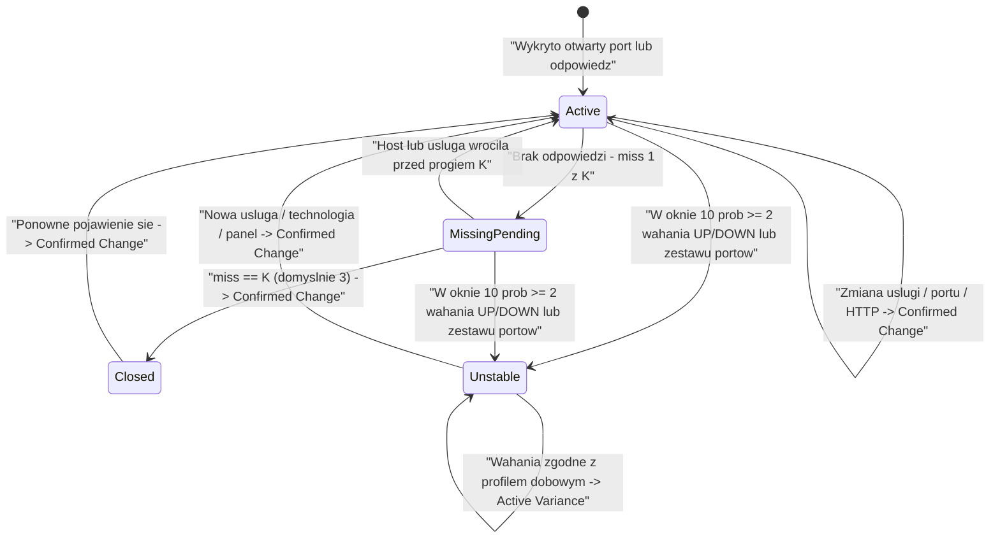

# Standard 04: Potok skanowania, Tarpit Guard, micro-chunking i Diff Engine

**Status:** Obowiązujący (Faza 0)  
**Data:** 2026-11-21

---

## 1. Potok skanowania bez redundancji (*Zero-Overlap Pipeline*)

Potok w `asi-worker` wykonuje trzy ściśle rozłączne etapy dla celów przekazanych w mikro-paczce. Żadne narzędzie nie powtarza pracy wykonanej przez etap wcześniejszy.

### 1.1. Etap 1: Host & Port Discovery (odsiew)
* **Narzędzie:** `Naabu` (domyślnie) lub `Masscan` (dla dużych bloków CIDR według polityki).
* **Parametry:** Wyłącznie wykrywanie otwartych portów w zdefiniowanym zakresie polityki (`-rate <rate_pps>`), bez skryptów i bez prób detekcji wersji usług.
* **Zasada braku ucinania portów:** Wszystkie otwarte porty zwrócone przez skaner są rejestrowane w komplecie i przekazywane do bazy — bez arbitralnego limitu odcięcia (np. „top 20”).
* **Bezpiecznik *Tarpit Guard*:**
  * Po zebraniu wyników Etapu 1 dla danego IP worker zlicza unikalne otwarte porty.
  * Jeśli liczba otwartych portów przekracza `policy.tarpit_port_threshold` (domyślnie **`200`**), host jest oznaczany flagą `probable_tarpit = true` (tag automatyczny `probable-tarpit`).
  * **Wszystkie odkryte porty są nadal zapisywane w bazie**, ale dla bezpieczeństwa okna skanowania **Etap 2 (`nmap -sV`) zostaje dla tego IP wstrzymany** i emitowane jest zdarzenie SSE `host.anomaly`.
  * Jedynie użytkownik z rolą **`Admin`** może jawnie wymusić wykonanie pełnego `nmap -sV` na konkretnym hoście (`tarpit_override_force_sv = true`).

### 1.2. Etap 2: Service & TLS Identification + Virtual Hosting
* **Narzędzie:** `Nmap` uruchamiany z flagami:
  `nmap -Pn -n -sV --version-intensity 2 --max-rate <rate> --scan-delay <delay> -p <exact_ports_from_stage_1> <ip>`
* **Parser TLS i rDNS w Ruście:** Dla portów TLS/nieznanych (lub zidentyfikowanych jako `ssl/*` / `https`) równoległy klient w Ruście (`rustls` + `x509-parser`) nawiązuje pojedynczy uścisk dłoni TLS (bez żądań HTTP) i odczytuje:
  * odcisk SHA-256 certyfikatu, `Subject CN`, `Issuer CN`, `NotBefore`, `NotAfter`, flagę `is_self_signed`,
  * listę domen **`SAN` (Subject Alternative Name)** typu DNS.
* **Rozwiązywanie nazw (*Virtual Hosting*):**
  Dla każdego aktywnego portu webowego (wykrytego jako `http` lub `https` na **dowolnym porcie** — standardowym `80`/`443` lub niestandardowym np. `8080`, `8443`, `8888`, `9443`) budowana jest zdeduplikowana lista `vhost`:
  1. Nazwy domenowe dostarczone przez użytkownika w konfiguracji Grupy Zasobów wskazujące na ten adres IP.
  2. Nazwa z odwrotnego DNS (**rDNS / `PTR`**).
  3. Domeny wyciągnięte z pola **`SAN`** certyfikatu TLS (z pominięciem rekordów wieloznacznych `*`, jeśli brak konkretnej subdomeny, lub z zachowaniem jawnych subdomen).
  4. Adres IP jako **fallback**, jeśli brak domen lub aby uchwycić domyślny vhost serwera.

### 1.3. Etap 3: Web Fingerprinting & `FingerprintHub v4`
* **Silnik:** Natywny asynchroniczny silnik HTTP/HTTPS w Ruście (`tokio` + `reqwest`) realizujący **pasywne** zapytania dla każdej krotki `(ip, port, scheme, vhost)` z odpowiednim nagłówkiem `Host: <vhost>` oraz parametrem TLS `SNI = <vhost>`.
* **Standard sygnatur:** **`FingerprintHub v4` (YAML)** (kompatybilny z Nuclei/ObserverWard v4) jako jeden format dla reguł wbudowanych, synchronizowanych i tworzonych w UI.
* **Opcjonalny `Nuclei`:** Uruchamiany wyłącznie wtedy, gdy polityka ma `enable_nuclei = true` i dana reguła wymaga wieloetapowego dopasowania YAML niemożliwego do wyrażenia w jednym cyklu `GET`/`HEAD` (z przekazanym limitem `-rl <rate>`).
* **Granice pasywnej detekcji:**
  * Jednym zestawem żądań `GET`/`HEAD` (w tym pobranie `/favicon.ico` w pamięci dla obliczenia **`MurmurHash3`**) rejestruje się status HTTP, łańcuch przekierowań, `<title>`, odfiltrowane nagłówki, nazwy i flagi ciasteczek (`HttpOnly`, `Secure`, `SameSite` — **bez zapisywania wartości tokenów sesyjnych**).
  * Pasywne sprawdzenie ścieżek administracyjnych i środowisk (`/login`, `/admin`, `/version`) ogranicza się wyłącznie do sprawdzenia kodu odpowiedzi i nagłówków/tytułu — **bezwzględny zakaz wysyłania prób logowania, brute-force czy payloadów exploitacyjnych**.

---

## 2. Dynamic Micro-chunking, Interleaving, EMA/ETA i Hard Kill Switch

### 2.1. Wyliczanie rozmiaru mikro-paczki ($S_{\text{chunk}}$)
Przed utworzeniem paczek w `scan_chunks`, `asi-api` odfiltrowuje z celów Grupy Zasobów wszystkie wykluczenia (`exclude_cidr`) i `ignored_targets`, otrzymując $N_{\text{IP}}$ celów do przeskanowania.

Docelowy czas trwania jednej paczki ustala się w przedziale **$30\text{--}90\text{ s}$** (wartość bazowa $T_{\text{target\_chunk}} = 45\text{ s}$), aby zapewnić responsywność *Kill Switcha* oraz płynną aktualizację ETA:

$$S_{\text{raw}} = \left\lfloor \frac{R_{\text{rate}} \times T_{\text{target\_chunk}}}{\max(1, N_{\text{ports\_est}})} \right\rfloor, \quad S_{\text{chunk}} = \operatorname{clamp}(S_{\text{raw}}, 4, 64)$$

*(Dla skanu całego zakresu `1-65535` z niskim `rate` przyjmuje się dolną granicę `4` IP na paczkę, a przy szybkich skanach wąskiej listy portów górną granicę `64` IP.)*

### 2.2. Interleaving (naprzemienność podsieci)
Paczki grupuje się według prefiksów `/24` (`subnet_bucket`) i układa w kolejce metodą *round-robin* po podsieciach (`sequence_no`), dzięki czemu ruch rozkłada się równomiernie na różne wydziały/segmenty AGH zamiast wysycać jedną podsieć naraz.

### 2.3. Pre-flight Check i Live EMA / ETA
* **Przed startem (*Pre-flight*):**
  $$T_{\text{est}} = \frac{N_{\text{IP}} \times N_{\text{ports}}}{R_{\text{rate}}} + N_{\text{chunks}} \times T_{\text{overhead}}$$
  gdzie $T_{\text{overhead}} \approx 2.5\text{ s}$ na narzut uruchomienia narzędzi w paczce. API porównuje $T_{\text{est}}$ z długością aktywnego okna czasowego $T_{\text{window}}$ i ostrzega użytkownika w UI, jeśli skan będzie wymagał podziału na wiele okien.
* **W trakcie działania (Live EMA):**
  Po każdej ukończonej paczce o czasie $d_i$ aktualizowana jest wykładnicza średnia krocząca ze współczynnikiem wygładzania $\alpha = 0.25$:
  $$T_{\text{avg}}^{(i)} = \begin{cases} d_1 & \text{dla } i = 1 \\ 0.25 \cdot d_i + 0.75 \cdot T_{\text{avg}}^{(i-1)} & \text{dla } i > 1 \end{cases}$$
  $$\text{ETA} = N_{\text{remaining\_chunks}} \times T_{\text{avg}}^{(i)}$$

### 2.4. Implementacja *Hard Kill Switch* na poziomie systemu operacyjnego
1. Każdy podproces (`naabu`, `masscan`, `nmap`, `nuclei`) uruchamiany jest w **osobnej grupie procesów Linux** (`pre_exec` wywołujące `setsid()` / `setpgid(0, 0)`) z ustawionym `kill_on_drop(true)` w `tokio::process::Command`.
2. Po odebraniu sygnału `stop_scan_run` / `stop_chunk` przez SSE lub zakończeniu okna czasowego:
   * Worker natychmiast wysyła `SIGTERM` do całej grupy procesów (`-pgid`) i anuluje wewnętrzne żądania HTTP `reqwest` przez `CancellationToken`.
   * Czeka maksymalnie `policy.kill_grace_seconds` (domyślnie **`3 s`**, zakres `1..10 s`) na bezpieczny zrzut bieżących wyników.
   * Po upływie czasu łaski wysyła **`SIGKILL`** do całej grupy procesów (`-pgid`) i zwraca paczkę do `asi-api` przez `/release` ze statusem `PENDING`.

---

## 3. Silnik zmian (Diff Engine) i obsługa hostów niestabilnych

### 3.1. Maszyna stanów aktywności i niestabilności

### 3.2. Klasyfikacja pól: monitorowane vs ignorowane (filtrowanie szumu)

| Kategoria | Pola wyzwalające diff (monitorowane) | Pola ignorowane (odfiltrowany szum) |
|---|---|---|
| **Sieć / Porty** | Status hosta (`active` / `inactive`), lista otwartych portów TCP/UDP, flaga `probable-tarpit` | Krótkotrwałe pojedyncze zaniki poniżej progu nieaktywności $K$ (chyba że wyzwolą `active_variance`) |
| **Usługi (`Nmap`)** | `service_name`, `product`, `version`, `tunnel` | Zmienne wartości czasu odpowiedzi, numery PID/portów źródłowych w banerach diagnostycznych |
| **Certyfikaty TLS** | `sha256_fingerprint`, `subject_cn`, `issuer_cn`, `san_dns`, `not_after`, `is_self_signed` | Kolejność identycznych wpisów w tablicy `san_dns` (tablica sortowana kanonicznie przed porównaniem) |
| **HTTP / Web** | `http_status`, `redirect_target`, `<title>`, `favicon_mmh3`, dopasowane technologie (`FingerprintHub`), `detected_paths` (`/admin`, `/login`, `/version`) | Zmienne nagłówki techniczne: `Date`, `ETag`, `Age`, `Expires`, `Last-Modified`, `X-Request-Id`, `X-Correlation-Id`, `CF-Ray`, `X-Amz-Cf-Id`, `Server-Timing`, dynamiczne tokeny CSRF w HTML |
| **Ciasteczka (`Set-Cookie`)** | **Nazwa ciasteczka** oraz **flagi bezpieczeństwa** (`HttpOnly`, `Secure`, `SameSite`) | **Wartość ciasteczka** (losowy token sesyjny nie jest nigdy porównywany ani zapisywany) |

### 3.3. Reguły rozróżniania „Hej, coś się zmieniło” vs „Hej, coś się zmienia”
1. **Próg nieaktywności ($K$, domyślnie `3`):**
   Pojedynczy brak odpowiedzi hosta lub portu przenosi obiekt do stanu `missing_pending` (`consecutive_misses += 1`). Dopiero osiągnięcie $K$ kolejnych nieudanych skanów zmienia stan na `closed` / `inactive` i generuje potwierdzony diff `- Zniknęła usługa` (`confirmed_change`).
2. **Detekcja hostów niestabilnych (`active_variance` — *„Hej, coś się zmienia”*):**
   * Scheduler realizuje próbkowanie w **4 przedziałach dobowych**: `00_06`, `06_12`, `12_18`, `18_24`.
   * Analizowane jest okno ostatnich **$M = 10$** próbek w `host_availability_samples`.
   * Jeśli host wykazuje **co najmniej `2` przejścia oscylacyjne** (`UP ↔ DOWN` lub naprzemienne pojawianie się i znikanie identycznego zestawu portów w różnych porach doby), otrzymuje tag `unstable` (`is_unstable = true`) oraz wyliczany jest profil dostępności per przedział (np. `06_12: 90%`, `00_06: 10%`).
   * Kolejne wahania mieszczące się w profilu generują wpis typu `active_variance` (bez szumiących alarmów krytycznych przy każdym cyklu dobowym).
   * **Wyjątek bezpieczeństwa:** Jeśli na hoście oznaczonym `unstable` pojawi się **zupełnie nowa, wcześniej niewidziana usługa, technologia lub panel `/admin`**, Diff Engine zawsze generuje alarm **`confirmed_change`**.

### 3.4. Kanoniczny format podsumowania w myślnikach (*Bullet-Point Changelog*)
Każdy element tablicy `bullet_items` w `diff_events` przechowywany jest strukturalnie (`op`: `+` | `-` | `~`, `key`, `params`), co pozwala renderować go spójnie w UI (PL/EN), SSE, webhookach oraz eksporcie:
* `+ Nowa usługa: 8443/tcp (HTTPS) — wykryto panel administracyjny (/admin)`
* `- Zniknęła usługa: 21/tcp (FTP) — brak odpowiedzi w 3 kolejnych skanach`
* `~ Zmiana technologii (443/tcp, portal.agh.edu.pl): Apache 2.4.49 -> Apache 2.4.58`
* `~ Zmiana tytułu strony (80/tcp): "Welcome to nginx!" -> "Portal Testowy Wydziału"`
* `~ Nowe ciasteczko (443/tcp): ADMIN_SESSION (HttpOnly=false)`
* `~ Zmienność dobowa (unstable): host aktywny głównie w godzinach 06:00–18:00`
