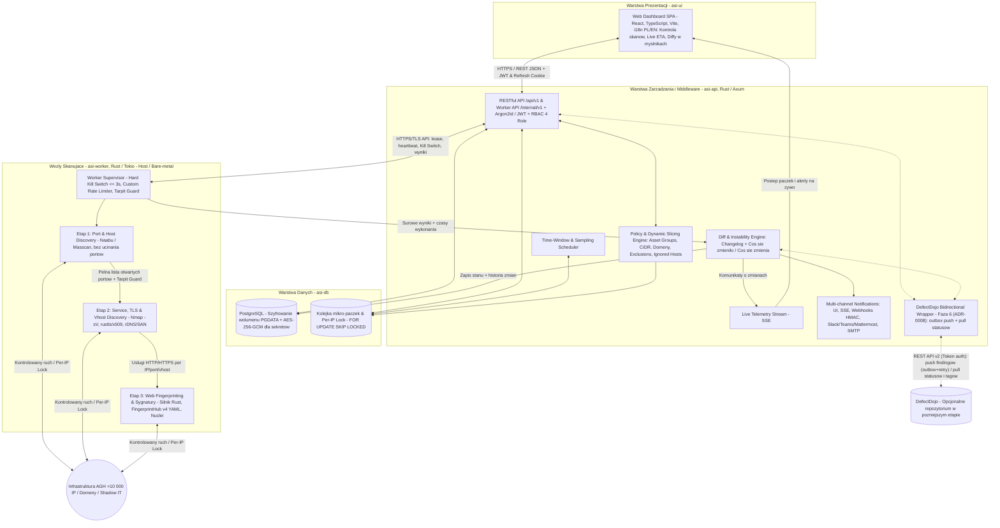
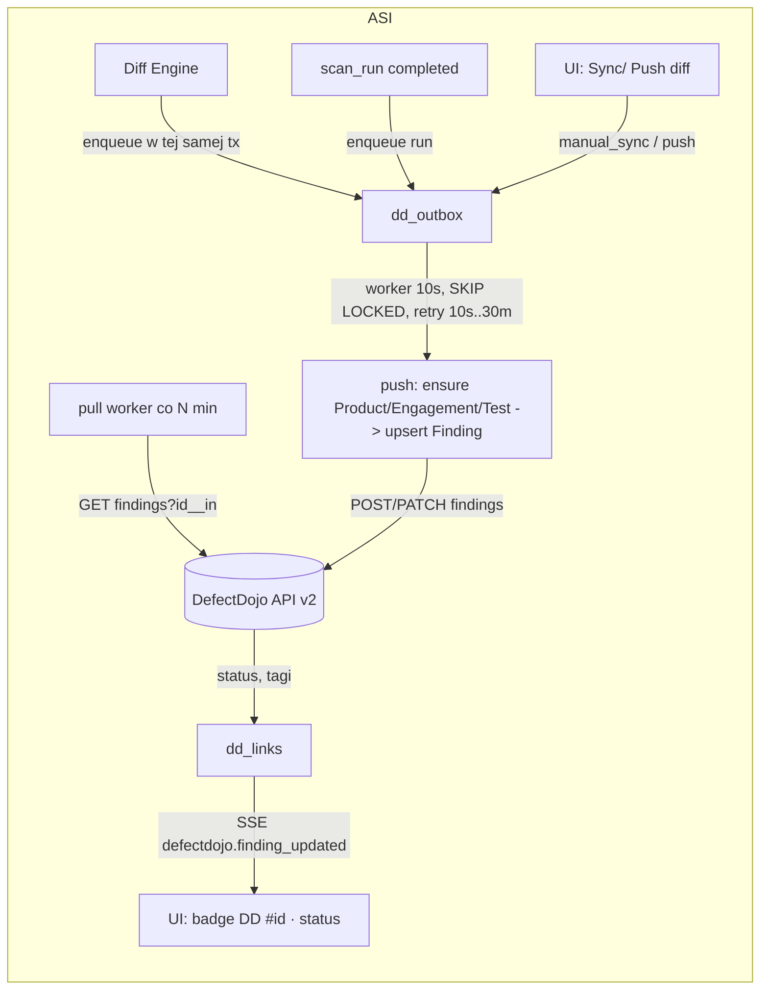

# Architektura Systemu: Attack Surface Intelligence (ASI)

## 1. Wizja i założenia architektoniczne

System **Attack Surface Intelligence (ASI)** jest modułową platformą typu **Middleware / Wrapper na DefectDojo** oraz orkiestratorem skanerów open-source zaprojektowanym dla Centrum Bezpieczeństwa Informacji AGH. Jego zadaniem jest bezpieczne, mało inwazyjne i cykliczne odkrywanie powierzchni ataku (w tym **Shadow IT**) w sieciach liczących powyżej $10\,000$ adresów IP, wykrywanie zmian w czasie oraz dwukierunkowa wymiana danych z platformą **DefectDojo**.

### Kluczowe pryncypia projektowe:

1. **Wrapper i dwukierunkowy pośrednik dla DefectDojo ($\text{DefectDojo} \Longleftrightarrow \text{ASI} \Longleftrightarrow \text{Skanery}$):** ASI obudowuje REST API v2 DefectDojo, dodając brakujące w nim funkcje operacyjne (harmonogramowanie w oknach czasowych dla $>10\,000$ IP, kontrolę intensywności, obsługę niestabilnych hostów, czytelne diffy zmian oraz uproszczony interfejs z 4 rolami RBAC), jednocześnie wykorzystując DefectDojo jako centralne repozytorium zasobów i znalezisk. **Zrealizowane w Fazie 6** (ADR-0008, standard 06): dwukierunkowa synchronizacja — push diffów jako findingi przez kolejkę outbox z retry oraz pull statusów/tagów z DD; szczegóły w sekcji 10.
2. **Architektura modułowa (nie-monolit):** System składa się z niezależnych, luźno powiązanych usług (`asi-api`, `asi-worker`, `asi-ui`, `asi-db`) komunikujących się przez RESTful API oraz kolejkę zadań w bazie danych. Pozwala to na niezależne skalowanie węzłów skanujących i łatwą rozbudowę.
3. **Brak nakładania się funkcji skanerów (*Zero-Overlap Pipeline*):** Każde narzędzie w potoku wykonuje ściśle określony wycinek pracy. System nigdy nie skanuje tego samego hosta pod tym samym kątem dwukrotnie z rzędu i nie nakłada sztucznych limitów ucinających liczbę wykrytych portów.
4. **Ciągły cykl przetwarzania (model z notatki projektowej):**
   $$\text{Skan} \longrightarrow \text{Wykrycie zmian (Diff)} \longrightarrow \text{Komunikat o zmianach} \longrightarrow \text{Zapis} \circlearrowleft$$
5. **Pełna kontrola operacyjna i niska inwazyjność:** Dynamiczny podział dużych zakresów IP na mikro-paczki, twardy limit czasu zakończenia/ubicia procesu (maks. kilka sekund po sygnałach *Stop/Timeout*), w pełni konfigurowalne limity tempa (zarówno przez flagi skanerów, jak i po stronie orkiestratora) oraz lista hostów ignorowanych.
6. **Prawda po stronie skanu (*Scan-First Truth*):** Administrator może ręcznie edytować dane w systemie, jednak kolejny przebieg skanu ma priorytet i aktualizuje stan hosta zgodnie z rzeczywistością sieciową (z zachowaniem historii zmian i możliwością dodania hosta do listy ignorowanych).

### Inspiracje Open Source zaadaptowane w projekcie:
* **`0x727/FingerprintHub` (+ silnik `ObserverWard` w Ruście):** Natywny format sygnatur detekcyjnych (YAML/JSON) ładowanych z repozytorium (z opcją automatycznej synchronizacji) oraz tworzonych przez użytkowników w UI.
* **`CERT-Polska/Artemis`:** Blokada *Per-IP Lock* (gwarancja, że tylko jeden moduł/worker odpytuje dany adres IP w danej chwili) oraz automatyczne kierowanie usług HTTP wykrytych na niestandardowych portach do modułu fingerprintingu webowego.
* **`oasm-platform/open-asm` (OASM):** Grupowanie zasobów (*Asset Groups*), tagowanie, model abstrakcji konektorów skanujących oraz wykonanie zadań w tle niezależnie od sesji przeglądarki.

---

## 2. Diagram architektury modułowej

---

## 3. Potok skanowania bez redundancji (*Zero-Overlap Pipeline*)

Aby uniknąć wielokrotnego skanowania tego samego hosta pod tym samym kątem, proces skanowania podzielony jest na **trzy rozłączne etapy**, gdzie wynik poprzedniego etapu stanowi bezpośrednie wejście kolejnego:

### Etap 1: Szybki Host & Port Discovery (odsiew)
* **Narzędzia:** `Naabu` (lub `Masscan` dla bardzo dużych bloków CIDR) uruchomiony wyłącznie w trybie wykrywania otwartych portów zdefiniowanych w polityce skanowania (bez skryptów i detekcji wersji).
* **Brak sztucznego przycinania portów:** Wszystkie otwarte porty wykryte w ramach skonfigurowanego zakresu są w całości rejestrowane i przekazywane dalej do Etapu 2 bez arbitralnych limitów odcięcia.
* **Bezpiecznik *Tarpit Guard*:** Jeśli liczba otwartych portów na pojedynczym adresie IP przekroczy konfigurowalny próg anomalii (domyślnie `> 200` portów), wszystkie wykryte porty nadal zostają zapisane w bazie bez ucinania, natomiast host otrzymuje flagę `probable-tarpit`, a Etap 2 (`nmap -sV`) jest dla niego bezpiecznie wstrzymywany, aby nie zablokować okna czasowego paczki (z możliwością ręcznego wymuszenia pełnego skanu przez rolę `Admin`).
* **Rezultat:** Odfiltrowanie nieaktywnych adresów IP przy zachowaniu kompletnego obrazu otwartych portów na aktywnych hostach.

### Etap 2: Identyfikacja usług, certyfikatów TLS i nazw (Virtual Hosting)
* **Narzędzia:** `Nmap` uruchamiany z flagami `-Pn -n -sV --version-intensity 2` **wyłącznie na konkretnych portach otwartych wykrytych w Etapie 1** (brak ponownego skanowania portów!) oraz lekki parser certyfikatów X.509 w Ruście (`rustls` + `x509-parser`).
* **Odkrywanie nazw dla Virtual Hostingu:** System przyjmuje jako cele zarówno zakresy IP/CIDR, jak i domeny/vhosty, a w Etapie 2 dodatkowo wzbogaca hosty o nazwy odkryte przez odwrotny DNS (`PTR`/rDNS) oraz pola `SAN` certyfikatów TLS.
* **Przekierowanie niestandardowych portów webowych (wzorzec z Artemis):** Każda usługa zidentyfikowana w Etapie 2 jako `http` lub `https` (niezależnie czy działa na porcie `80`, `443`, `8080`, `8443` czy dowolnym innym wysokim porcie) trafia na listę wejściową Etapu 3 w postaci krotek `(ip, port, vhost)`.

### Etap 3: Fingerprinting HTTP/HTTPS i silnik sygnatur
* **Narzędzia:** Własny, wysokowydajny silnik asynchroniczny w **Ruście** (`tokio` + `reqwest`) zintegrowany z bazą sygnatur **`0x727/FingerprintHub` (natywny format v4 YAML)** oraz opcjonalnie `Nuclei` (uruchamiany wyłącznie dla szablonów wymagających wieloetapowych dopasowań YAML). Każda para `(ip, port, vhost)` fingerprintowana jest osobno z ustawieniem właściwego nagłówka `Host` oraz TLS `SNI`.
* **Zakres pasywnej detekcji (jednym zestawem żądań `GET`/`HEAD`):**
  * kod odpowiedzi HTTP, łańcuch przekierowań, tytuł strony (`<title>`),
  * nagłówki odpowiedzi HTTP oraz nazwy i flagi ciasteczek (`Set-Cookie`),
  * metadane certyfikatu TLS (CN, SAN, wystawca, daty ważności),
  * hash favicony (MurmurHash3) wyliczany w pamięci,
  * wykrywanie technologii: CMS, framework, serwer aplikacyjny, urządzenie IoT,
  * rozpoznawanie środowisk `staging`/`test` oraz paneli administracyjnych (`/login`, `/admin`, `/version` — wyłącznie pasywne sprawdzenie obecności, **zero prób logowania**).
* **Zarządzanie sygnaturami:** Natywny format **`FingerprintHub v4` (YAML)** (kompatybilny z Nuclei/ObserverWard v4) stanowi jeden spójny standard dla reguł wbudowanych, reguł synchronizowanych z repozytorium `FingerprintHub` (jednym kliknięciem w UI przez `Admina`) oraz własnych sygnatur tworzonych przez analityków w panelu.

---

## 4. Kontrola wykonywania, dynamiczne paczki i limity tempa

### 4.1. Dynamiczny podział przestrzeni adresowej (*Dynamic Micro-chunking*)
Zamiast sztywnego rozmiaru paczki, orkiestrator przed startem skanu wylicza optymalny rozmiar mikro-paczki $S_{\text{chunk}}$ dynamicznie na podstawie:
* liczby celów po odjęciu wykluczeń i hostów ignorowanych ($N_{\text{IP}}$),
* długości zadanego okna czasowego ($T_{\text{window}}$),
* skonfigurowanego limitu prędkości ($R_{\text{rate}}$).

Paczki z różnych podsieci są układane w kolejce naprzemiennie (**Interleaving**), co równomiernie rozkłada ruch w sieci AGH i stabilizuje estymację czasu zakończenia ($\text{ETA}$).

### 4.2. Dwupoziomowa kontrola intensywności (*Custom Rate Limiting*)
Użytkownik może w pełni konfigurować ograniczenia ruchu na poziomie profilu globalnego, grupy zasobów, podsieci CIDR oraz pojedynczego hosta:
1. **Poziom narzędzi (flagi CLI):** Orkiestrator tłumaczy parametry polityki na natywne flagi skanerów (np. `-rate` w Naabu, `--max-rate` i `--scan-delay` w Nmap, `-rl` w Nuclei).
2. **Poziom orkiestratora (Rust Supervisor):**
   * **Per-IP Lock & Cooldown:** Gwarancja, że w danej chwili tylko jeden proces komunikuje się z danym adresem IP, z wymuszonym minimalnym odstępem między zapytaniami do tego samego hosta.
   * **Limit współbieżności:** Kontrola liczby równoległych mikro-paczek per podsieć.

### 4.3. Twarde zatrzymywanie (*Hard Kill Switch*) i kontrola okna czasowego
* Gdy użytkownik kliknie **Zatrzymaj / Pauza** lub skończy się okno czasowe:
  * Worker wysyła sygnał zakończenia do aktywnych mikro-paczek i daje im **maksymalnie kilka sekund (konfigurowalne, domyślnie $3\text{--}5\text{ s}$)** na bezpieczne dokończenie bieżącego żądania i zapisanie wyników.
  * Po upływie tego czasu procesy potomne (`naabu`, `nmap`, `nuclei`) są natychmiast ubijane (`SIGKILL` / `kill_on_drop(true)`), a niedokończona mikro-paczka wraca do kolejki ze stanem `PENDING` do wznowienia w kolejnym oknie.

### 4.4. Wyliczanie postępu i czasu trwania ($\text{ETA}$)
* **Przed startem (*Pre-flight Check*):** System oblicza szacowany czas skanu:
  $$T_{\text{est}} = \frac{N_{\text{IP}} \times N_{\text{ports}}}{R_{\text{rate}}} + N_{\text{chunks}} \times T_{\text{overhead}}$$
  i informuje, czy zadanie zmieści się w jednym oknie czasowym.
* **W trakcie działania (Live EMA):** Po każdej ukończonej mikro-paczce aktualizowana jest wykładnicza średnia krocząca czasu paczki ($T_{\text{avg}}$), a frontend otrzymuje przez **SSE** aktualny procent postępu, prędkość skanowania oraz pozostały czas:
  $$\text{ETA} = N_{\text{remaining\_chunks}} \times T_{\text{avg}}$$

---

## 5. Silnik zmian (Diff Engine), komunikaty i hosty niestabilne

Zgodnie z założeniami z notatki projektowej, po każdym przebiegu (lub ukończonej paczce) system realizuje logikę: **Skan $\longrightarrow$ Analiza zmian $\longrightarrow$ Komunikat o zmianach $\longrightarrow$ Zapis**.

### 5.1. Dwa rodzaje komunikatów o zmianach
System rozróżnia dwa stany wykryte pomiędzy kolejnymi przebiegami skanów:

1. **„Hej, coś się zmieniło” (*Confirmed State Change*):**
   * Generowany, gdy między skanem $N-1$ a skanem $N$ zaszła konkretna, jednoznaczna zmiana w infrastrukturze lub gdy host/usługa nie odpowiedziała przez skonfigurowaną liczbę kolejnych skanów (próg nieaktywności ustawiany w polityce, np. $3$ kolejne nieudane próby).
2. **„Hej, coś się zmienia” (*Active Variance / Time-of-Day Drift*):**
   * Generowany dla hostów niestabilnych, które odpowiadają inaczej w zależności od pory dnia lub okresowo pojawiają się i znikają (np. stacje robocze w laboratoriach, serwery uruchamiane harmonogramem).
   * Scheduler realizuje **próbkowanie o różnych porach doby** (np. rano, po południu, w nocy) i buduje profil dostępności czasowej hosta, zamiast generować fałszywe alarmy przy każdym cyklu dobowym.

### 5.2. Czytelne podsumowanie zmian w myślnikach (*Bullet-Point Changelog*)
Dla każdego zmienionego hosta UI oraz eksport generują zwięzłą listę różnic w myślnikach pomiędzy skanem poprzednim a bieżącym, np.:
* `+ Nowa usługa: 8443/tcp (HTTPS) — wykryto panel administracyjny (/admin)`
* `- Zniknęła usługa: 21/tcp (FTP) — brak odpowiedzi w 3 kolejnych skanach`
* `~ Zmiana technologii: Apache 2.4.49 -> Apache 2.4.58`
* `~ Zmiana tytułu strony (80/tcp): "Welcome to nginx!" -> "Portal Testowy Wydziału"`
* `~ Nowe ciasteczko (443/tcp): ADMIN_SESSION (HttpOnly=false)`

### 5.3. Granularność diffów (filtrowanie szumu)
Aby raporty zmian zawierały wyłącznie istotne informacje dla zespołu bezpieczeństwa:
* **Pola monitorowane (wyzwalają diff):** status hosta (aktywny/nieaktywny), lista otwartych portów, nazwa i wersja usługi, kod odpowiedzi HTTP, tytuł strony (`<title>`), cel przekierowania, odcisk/CN/SAN/data wygaśnięcia certyfikatu TLS, wykryte technologie (`FingerprintHub`), nazwy i flagi bezpieczeństwa ciasteczek.
* **Pola ignorowane w diffach (odfiltrowany szum):** zmienne nagłówki czasowe/techniczne (`Date`, `ETag`, `Age`, `X-Request-Id`, `CF-Ray`) oraz losowe wartości tokenów sesyjnych w ciasteczkach (śledzimy nazwę ciasteczka, nie jego dynamiczny hash).

### 5.4. Priorytet skanu i Lista Ignorowanych (*Ignored Hosts*)
* **Priorytet skanu:** Administrator może edytować dowolne pole zasobu lub znaleziska w UI (np. dopisać komentarz, skorygować tag czy opis), ale **kolejny skan zawsze ma priorytet** i aktualizuje parametry techniczne hosta do aktualnego stanu wykrytego w sieci (zapisując poprzednią wartość w historii audytowej).
* **Lista Ignorowanych:** Z poziomu widoku hosta lub zmiany administrator może jednym kliknięciem dodać adres IP/domenę do **Listy Ignorowanych** (z podaniem powodu), co wyłącza host z przyszłych skanów i alertów zmian.

### 5.5. Wielokanałowe dostarczanie komunikatów (`NotificationSink`)
Komunikaty *„Hej, coś się zmieniło”* oraz *„Hej, coś się zmienia”* są dostarczane wielokanałowo poprzez ujednolicony interfejs `NotificationSink`:
* centrum powiadomień w interfejsie **UI** oraz strumień na żywo **SSE**,
* konfigurowalne per Grupa Zasobów **webhooki JSON** (podpisywane nagłówkiem `HMAC-SHA256`), gotowe presety dla **Slack / Microsoft Teams / Mattermost** oraz opcjonalny kanał **SMTP**.

---

## 6. ASI jako Wrapper i Middleware dla DefectDojo ($\text{DefectDojo} \Longleftrightarrow \text{ASI}$)

> [!NOTE]
> **Status etapu (`ADR-0007`):** Integracja z DefectDojo zostaje świadomie **odłożona do późniejszej fazy wdrożenia (Faza 6)**, aby w pierwszej kolejności zbudować w pełni autonomiczny, niezawodny rdzeń platformy ASI (*standalone*). Model bazy danych zachowuje neutralny punkt rozszerzenia (`external_refs JSONB`), natomiast poniższe podsekcje dokumentują docelową wizję tej integracji na moment powrotu do tematu.

### 6.1. Dlaczego ASI pełni rolę Wrapper / Middleware na DefectDojo?
DefectDojo jest standardem w zarządzaniu podatnościami i triażu znalezisk, jednak nie jest przystosowane do bezpośredniego orkiestrowania cyklicznych skanów discovery na $>10\,000$ adresach IP, pilnowania okien czasowych, profilowania hostów niestabilnych ani prezentowania prostych różnic między skanami. 

**ASI działa jako warstwa pośrednicząca (*Wrapper*):**
* Z perspektywy analityka ASI udostępnia prosty, przejrzysty interfejs dopasowany do 4 ról RBAC, pozwalający zarządzać skanami i przeglądać wyniki bez konieczności bezpośredniego przeklikiwania rozbudowanego panelu DefectDojo.
* Pod spodem ASI wymienia dane **dwukierunkowo** z REST API v2 DefectDojo, traktując DefectDojo jako centralne repozytorium zasobów (*Endpoints*), znalezisk (*Findings*) i decyzji triażowych.

### 6.2. Dwukierunkowa wymiana danych ($\text{ASI} \Longleftrightarrow \text{DefectDojo}$)

#### Kierunek 1: $\text{ASI} \longrightarrow \text{DefectDojo}$ (Zasilanie zasobami, wynikami i zmianami)
1. **Synchronizacja zasobów (*Endpoints*):** Każdy wykryty aktywny host, otwarty port oraz usługa HTTP/HTTPS są rejestrowane i aktualizowane jako `Endpoints` w odpowiednim `Product / Engagement` DefectDojo (zmapowanym na **Grupę Zasobów** w ASI).
2. **Import wyników i obserwacji (`reimport-scan` / `findings`):** Znormalizowane wyniki ze skanerów (Naabu, Nmap) oraz dopasowania z silnika sygnatur (np. wykryte Shadow IT, nieznany CMS, panel `/admin`, środowisko `staging`, nietypowe ciasteczka) są wypychane do DefectDojo jako znaleziska informacyjne (*Informational Findings*) wraz z pełnym materiałem dowodowym (*Evidence*).
3. **Propagacja cyklu życia i zmian (Diff):**
   * Gdy usługa zniknie w kolejnych skanach (przekroczy próg nieaktywności), ASI wysyła aktualizację statusu powiązanego znaleziska/endpointu w DefectDojo (oznaczając je jako nieaktywne/zamknięte).
   * Gdy administrator doda host do **Listy Ignorowanych** lub zedytuje opis/tagi w ASI, zmiana ta jest propagowana do DefectDojo (np. jako tag lub zmiana statusu na `Out of Scope` / `Risk Accepted`).

#### Kierunek 2: $\text{DefectDojo} \longrightarrow \text{ASI}$ (Pobieranie inwentarza, kontekstu i decyzji triażowych)
1. **Import celów i bazy odniesienia z DefectDojo:** ASI pobiera z DefectDojo istniejące `Products`, `Engagements` oraz listę znanych `Endpoints` (`/api/v2/endpoints/`). Pozwala to na:
   * automatyczne zasilenie grupy skanowania adresami już zarejestrowanymi w DefectDojo (cykliczna weryfikacja znanego inwentarza),
   * natychmiastowe odróżnienie **znanego zasobu** (obecnego już w DefectDojo) od **nowego Shadow IT** (wykrytego w sieci, ale nieistniejącego w DefectDojo).
2. **Odczyt decyzji triażowych analityków:** Jeśli zespół bezpieczeństwa oznaczy w DefectDojo dane znalezisko lub endpoint jako `False Positive`, `Risk Accepted` lub `Out of Scope`, ASI pobiera ten status podczas cyklicznej synchronizacji i prezentuje go bezpośrednio w swoim interfejsie (*Wrapper UI*), opcjonalnie proponując przeniesienie hosta na Listę Ignorowanych.
3. **Zasada rozwiązywania konfliktów:** Rzeczywistość sieciowa z najnowszego skanu ASI zawsze decyduje o stanie technicznym portu/usługi (np. czy port jest otwarty), natomiast statusy analityczne z DefectDojo (`Verified`, `Risk Accepted`, `False Positive`) wzbogacają widok w ASI jako kontekst decyzyjny.

---

## 7. RBAC, grupowanie, import/eksport i bezpieczeństwo danych

### 7.1. Uwierzytelnianie i RBAC (4 role)
* **Uwierzytelnianie (wyłącznie konta lokalne, bez OIDC/SSO):** Konta użytkowników przechowywane w bazie PostgreSQL (hasła hashowane `Argon2id`) + krótkotrwały **JWT Access Token** (`15 min`) oraz rotowany **Refresh Token** w ciasteczku `HttpOnly; Secure; SameSite=Strict` z tabelą sesji i wykrywaniem ponownego użycia tokenu. Węzły skanujące (`asi-worker`) uwierzytelniają się dedykowanymi tokenami maszynowymi (hashowanymi w DB) po HTTPS/TLS.
* **4 wbudowane role egzekwowane przez middleware i ekstraktory w Axum:**
  1. **`Admin`** — pełne zarządzanie systemem: użytkownicy i role, polityki i globalne limity rate, synchronizacja repozytorium `FingerprintHub v4`, wymuszanie pełnego `nmap -sV` na hostach `probable-tarpit`, kanały powiadomień/webhooki, rejestracja i unieważnianie workerów, inspekcja `audit_log` oraz przyszła konfiguracja integracji zewnętrznych.
  2. **`ReadWriteDelete`** — zarządzanie grupami zasobów (cele IP/CIDR/domeny, wykluczenia, harmonogramy), uruchamianie i zatrzymywanie skanów, edycja tagów ręcznych i opisów, import/eksport JSON, usuwanie celów/wyników lokalnych, zarządzanie *Listą Ignorowanych* oraz tworzenie i edycja własnych sygnatur `FingerprintHub v4` w UI.
  3. **`ReadWrite`** — uruchamianie oraz zatrzymywanie/pauza zdefiniowanych skanów, edycja tagów ręcznych, notatek i opisów *(oraz w przyszłości ręczne wyzwalanie synchronizacji z zewnętrznymi systemami)*.
  4. **`ReadOnly`** — podgląd dashboardu, hostów, usług, klastrów, listy zmian w myślnikach oraz eksport raportów i wyników do JSON.

### 7.2. Grupowanie, tagowanie oraz import/eksport danych
* **Grupowanie i tagi:**
  * Logiczne **Grupy Zasobów** (np. podsieci wydziałowe, infrastruktura serwerowa) z osobnymi harmonogramami, progami nieaktywności i opcjonalnym mapowaniem na systemy zewnętrzne w przyszłości.
  * Automatyczne **grupowanie podobnych usług** (np. po identycznym hashu favicony MurmurHash3, tytule strony lub wykrytym CMS-ie) ułatwiające szybkie namierzenie powielonych instancji Shadow IT.
  * Elastyczny system **tagów** (automatycznych z sygnatur, np. `admin-panel`, `staging`, `unstable`, `probable-tarpit`, oraz ręcznych).
* **Import i eksport (wyłącznie JSON):**
  * Eksport wyfiltrowanych wyników skanów, list hostów, celów, polityk, historii zmian (changelogów) oraz zestawów sygnatur do ustandaryzowanego formatu **JSON** (`schema_version: "1.0"`).
  * Import list celów (IP/CIDR/domeny), wykluczeń, sygnatur oraz zewnętrznych paczek wyników wyłącznie w formacie **JSON** przez ujednolicony walidator API.

### 7.3. Ochrona danych w spoczynku (*Encryption at Rest*)
* Wszystkie dane skanów, wyniki fingerprintingu, nagłówki, ciasteczka, tokeny integracyjne oraz dane użytkowników w bazie **PostgreSQL** chronione są za pomocą **domyślnego szyfrowania w spoczynku na poziomie wolumenu bazy danych (`PGDATA` oraz backupy na szyfrowanym wolumenie LUKS / systemowym Encryption at Rest)**, uzupełnionego o szyfrowanie na poziomie aplikacji **AEAD (`AES-256-GCM` z kluczem `ASI_MASTER_KEY`)** dla wrażliwych sekretów w bazie (sekrety webhooków, przyszłe tokeny integracyjne) oraz szyfrowaną komunikację **TLS 1.3** pomiędzy wszystkimi komponentami systemu.

---

## 8. Topologia wdrożeniowa: Docker vs Natywne Węzły Skanujące

Wdrożenie wieloskładnikowego systemu skanującego sieć $>10\,000$ IP wymaga świadomego rozdzielenia warstwy aplikacyjnej od warstwy sieciowej skanerów:

### Dlaczego tradycyjne kontenery Docker (bridge NAT) są wąskim gardłem dla skanerów?
Narzędzia takie jak `naabu` czy `nmap -sS` operują na surowych gniazdach (`CAP_NET_RAW`) i generują tysiące krótkotrwałych połączeń na sekundę. W domyślnej sieci Docker `bridge` każdy pakiet przechodzi przez mechanizm NAT i tablicę śledzenia połączeń jądra Linux (`nf_conntrack`), co przy masowym skanowaniu prowadzi do przepełnienia tablicy `conntrack`, gubienia pakietów i przekłamania wyników discovery.

### Rekomendowana topologia hybrydowa:
1. **Warstwa Zarządzania i Danych (Kontenery Docker / Compose):**
   * `asi-api` (Rust / Axum — orkiestrator, scheduler, diff engine, REST API)
   * `asi-ui` (SPA — React + TypeScript + Vite pod lekkim serwerem Nginx/Caddy)
   * `asi-db` (PostgreSQL na szyfrowanym wolumenie)
2. **Warstwa Wykonawcza — `asi-worker` (Natywna usługa `systemd` na hoście Linux lub `--network=host`):**
   * **W środowisku produkcyjnym AGH:** `asi-worker` wraz z binarkami (`naabu`, `nmap`, `nuclei`) oraz lokalną kopią sygnatur `FingerprintHub` instalowany jest **natywnie jako lekka usługa `systemd` na dedykowanym węźle skanującym** (VM / bare-metal z bezpośrednim interfejsem sieciowym). Eliminuje to narzut NAT Dockera, daje pełną wydajność surowych gniazd i pozwala łatwo dokładać kolejne węzły skanujące w różnych segmentach sieci, łączące się po HTTPS/TLS z `asi-api`.
   * **W środowisku deweloperskim / demo:** Ten sam kod może zostać uruchomiony w `docker-compose` z trybem `network_mode: host` na potrzeby szybkiej prezentacji lokalnej oraz z lokalnym środowiskiem testowym **Docker Mock-Lab**.

---

## 9. Dokumentacja standaryzacyjna i decyzje architektoniczne (ADR)

Szczegółowe standardy inżynieryjne, kontrakty i decyzje architektoniczne Fazy 0 znajdują się w katalogu `docs/`:

* **Indeks dokumentacji:** [`docs/README.md`](docs/README.md)
* **Standardy techniczne:**
  * [`docs/standards/01-engineering-standards.md`](docs/standards/01-engineering-standards.md) — struktura monorepo, konwencje Rust i TypeScript/React, i18n, logowanie, CI oraz Docker Mock-Lab
  * [`docs/standards/02-domain-and-data-model.md`](docs/standards/02-domain-and-data-model.md) — słownik domenowy, zasada *Scan-First Truth*, schemat PostgreSQL i diagram ER
  * [`docs/standards/03-api-worker-and-events.md`](docs/standards/03-api-worker-and-events.md) — publiczne REST API (`/api/v1/*`), RFC 9457, protokół `asi-worker` (`/internal/v1/worker/*`), SSE, `NotificationSink` i Import/Export CSV/JSON
  * [`docs/standards/04-pipeline-diff-and-instability.md`](docs/standards/04-pipeline-diff-and-instability.md) — potok Etapów 1–3, Tarpit Guard, Virtual Hosting, micro-chunking, EMA/ETA, Hard Kill Switch i maszyna stanów Diff Engine
  * [`docs/standards/05-rbac-and-security.md`](docs/standards/05-rbac-and-security.md) — macierz RBAC (4 role), lokalna autoryzacja Argon2id/JWT/Refresh, bezpieczeństwo workerów i szyfrowanie sekretów
  * [`docs/standards/06-defectdojo-integration.md`](docs/standards/06-defectdojo-integration.md) — **Faza 6:** dwukierunkowa integracja z DefectDojo (model danych, mapowanie, push/pull, API, UI, testy, runbook)
* **Decyzje architektoniczne (ADR):** [`docs/adr/README.md`](docs/adr/README.md) (`ADR-0001` – `ADR-0008`)
* **Plan realizacji:** [`docs/roadmap.md`](docs/roadmap.md) — fazy wdrożenia od szkieletu MVP po Fazę 6 (integracja z DefectDojo — ukończona)

---

## 10. Faza 6: dwukierunkowa integracja z DefectDojo (ADR-0008)

Zgodnie z notatką projektową (`DefectDojo ⇄ Rozwiązanie ⇄ Skanery`, `AGH będzie użytkownikiem`) ASI pełni rolę **middleware/wrappera**: publikuje wyniki skanów i diffów w DefectDojo jako findingi oraz pobiera z powrotem statusy triażu i tagi.

### 10.1 Mapowanie encji

| ASI | DefectDojo |
|---|---|
| `asset_group` | `Product` o nazwie `ASI: <nazwa grupy>` (tag `asi`) |
| `scan_run` | `Engagement` (`ASI scan <id>`) + jeden `Test` typu `ASI Attack Surface Scan` |
| `diff_event` | `Finding` (upsert idempotentny po `unique_id_from_tool = <UUID diff_event>`) |
| aktywny host (scope `inventory`) | `Finding` `Info` z `unique_id_from_tool = host:<UUID>` |

ID obiektów DD trzymane są w `external_refs JSONB` (`asset_groups`, `scan_runs`, `hosts`) i w tabeli `dd_links` (per diff: product/engagement/test/finding + ostatni status z DD).

### 10.2 Przepływ danych

* **Push (ASI → DD):** bez `reimport-scan` (pułapka przy mikro-paczkach — ADR-0007); bezpośrednie `POST/PATCH /api/v2/findings/` z `unique_id_from_tool`, kolejka `dd_outbox` z backoff `10s, 30s, 2m, 10m, 30m`, hooki: po każdym diffie (z filtrem `finding_scope`) i gdy run przechodzi w `completed`.
* **Pull (DD → ASI):** co `pull_interval_minutes` pobierane są statusy/tag (`GET /api/v2/findings/?id__in=…`) dla wszystkich linkowanych findingów → `dd_links` + SSE; statusy w DD są tylko odczytywane (triage należy do analityka w DD).
* **Zakres findingów (konfigurowalny):** `changes` (tylko `confirmed_change`) / `all_diffs` (+ `active_variance`) / `inventory` (+ hosty jako `Info`).
* **Bezpieczeństwo:** API key konta „AGH” w DD tylko jako AES-256-GCM w `defectdojo_config`; RBAC `manage_external_integrations` (Admin) dla mutacji; `audit_logs`; TLS do DD.
* **API:** `/api/v1/integrations/defectdojo` (GET/PUT config, `test-connection`, `sync`, `push/{diff}`, `link/{diff}`, `outbox`) — szczegóły w standardzie 06; **UI:** zakładka „Integracje (DefectDojo)” + badge `DD #id · status` na diffach.
* **Testy:** `crates/asi-api/tests/dd_integration.rs` (mock API v2 + pełny flow na żywym PostgreSQL); dev: `docker compose --profile dd`.